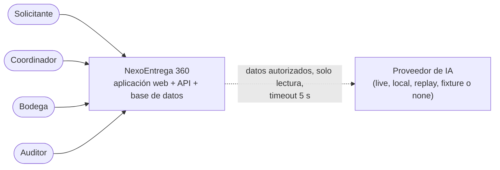
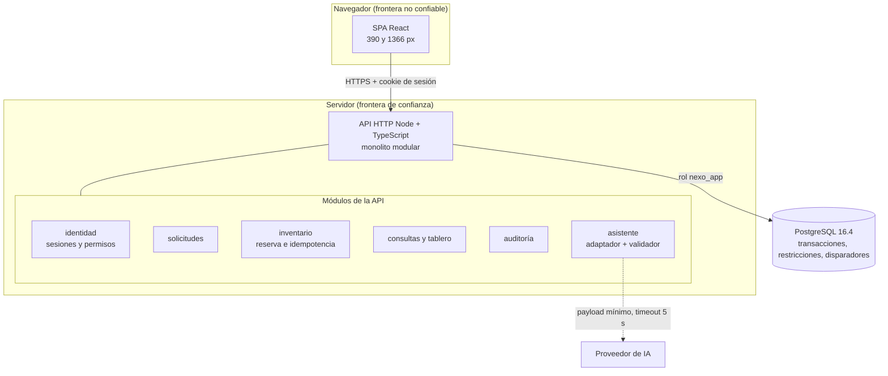
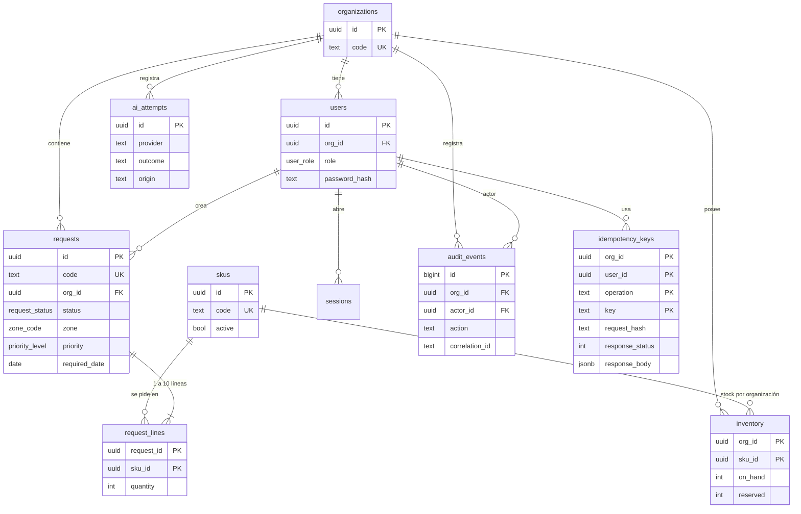
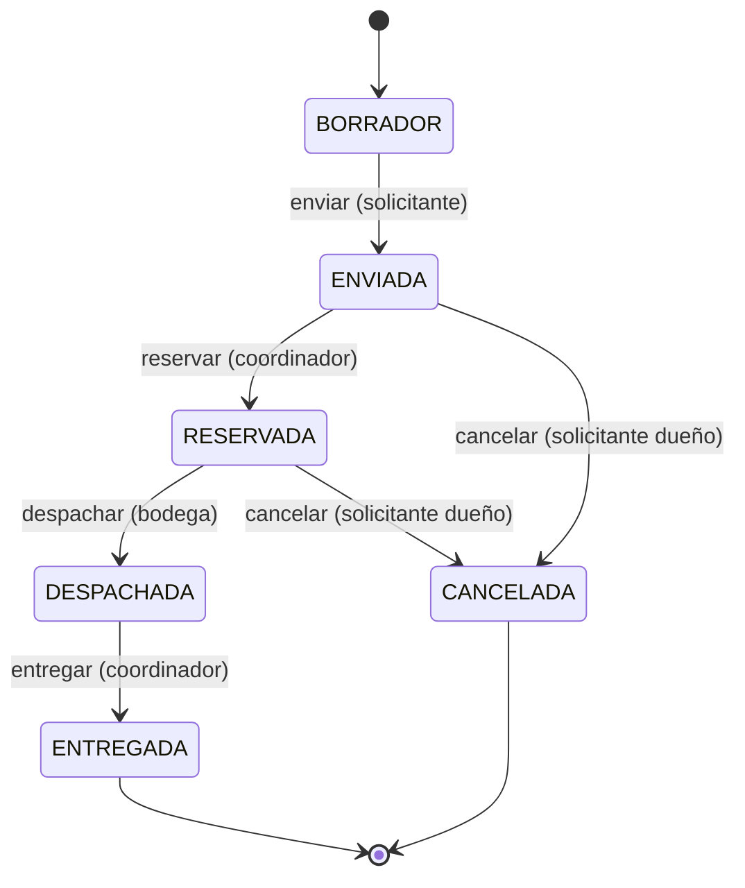
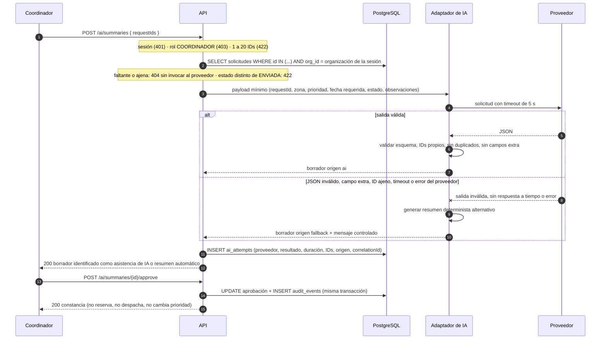
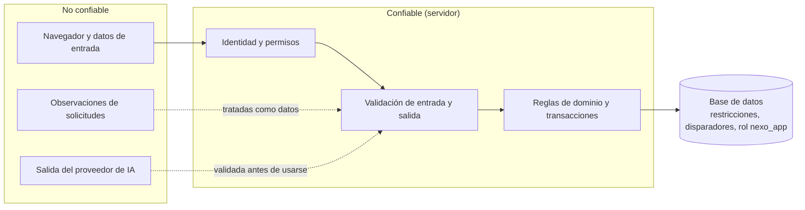

# Arquitectura de NexoEntrega 360

Versión 0.1.0 (diseño para G2) · Autor: Yefrey (con asistencia de IA) · Revisor: PENDIENTE (persona distinta al autor) · Fecha UTC de revisión: PENDIENTE · Commit revisado: PENDIENTE

Estado: diseño aprobado solo cuando la revisión anterior esté completa. Los diagramas deben coincidir con el código de la versión entregada; la comprobación se registra en la revisión de convergencia (G4). Hasta entonces describen la intención, no el código.

Decisiones relacionadas: [ADR-0001](adr/ADR-0001-estructura-y-limites.md), [ADR-0002](adr/ADR-0002-transacciones-e-idempotencia.md), [ADR-0003](adr/ADR-0003-autenticacion-y-aislamiento.md), [ADR-0004](adr/ADR-0004-integracion-de-ia-y-degradacion.md).

## 1. Contexto



El proveedor de IA es un sistema externo no confiable. Es opcional: sin él, el sistema funciona completo.

## 2. Contenedores y componentes



Reglas de dependencia: la interfaz web solo habla con la API; los módulos acceden a la base solo a través de repositorios que siempre reciben la organización de la sesión; el módulo `asistente` no importa `inventario` ni puede escribir en él.

## 3. Datos



Invariantes en la base (además de la aplicación): `on_hand >= 0`, `reserved >= 0`, `reserved <= on_hand`, `quantity` entre 1 y 500, un SKU por solicitud, disparador de transiciones permitidas, disparador de 1 a 10 líneas al enviar, líneas inmutables fuera de BORRADOR y auditoría sin UPDATE, DELETE ni TRUNCATE. Disponible = `on_hand - reserved` se calcula, no se almacena.

## 4. Estados de una solicitud



Toda transición no dibujada se rechaza con 409 y no modifica datos ni inventario.

## 5. Secuencia de reserva concurrente

Esta secuencia implementa el [ADR-0002](adr/ADR-0002-transacciones-e-idempotencia.md) y debe mantenerse idéntica a él. Orden de bloqueo: fila de la clave de idempotencia, fila de la solicitud, filas de inventario por `sku_id` ascendente.

```mermaid
sequenceDiagram
  autonumber
  participant C1 as Coordinador 1 (A-001, clave K1)
  participant C2 as Coordinador 2 (A-002, clave K2)
  participant API as API
  participant DB as PostgreSQL

  par petición de C1
    C1->>API: POST /requests/A-001/reserve + Idempotency-Key K1
  and petición de C2
    C2->>API: POST /requests/A-002/reserve + Idempotency-Key K2
  end
  Note over API: 1 resolver sesión (401) · 2 rol COORDINADOR (403)<br/>3 cabecera presente (400) · 4 solicitud existe en su organización (404)
  API->>DB: BEGIN (C1)
  API->>DB: BEGIN (C2)
  API->>DB: INSERT idempotency_keys (K1) ON CONFLICT DO NOTHING
  API->>DB: INSERT idempotency_keys (K2) ON CONFLICT DO NOTHING
  Note over API,DB: clave nueva en ambas: continúan.<br/>Si la clave ya existía: mismo hash devuelve la respuesta guardada, hash distinto devuelve 409.
  API->>DB: SELECT solicitud A-001 FOR UPDATE (C1)
  API->>DB: SELECT solicitud A-002 FOR UPDATE (C2)
  Note over API: estado ENVIADA en ambas; si no, 409
  API->>DB: SELECT inventario del SKU FOR UPDATE ORDER BY sku_id (C1 lo obtiene)
  API->>DB: SELECT inventario del SKU FOR UPDATE (C2 espera a C1)
  Note over API,DB: C1 ve física 10, reservada 0: disponible 10 cubre 7
  API->>DB: UPDATE inventory reservada = 7 · UPDATE solicitud RESERVADA · INSERT audit_events · guarda respuesta 200 en K1
  API->>DB: COMMIT (C1)
  DB-->>API: C2 obtiene el bloqueo y lee física 10, reservada 7: disponible 3 no cubre 7
  API->>DB: guarda respuesta 409 en K2 sin tocar inventario ni estado · COMMIT (C2)
  API-->>C1: 200 RESERVADA
  API-->>C2: 409 disponibilidad insuficiente
  Note over DB: persistido: física 10, reservada 7, disponible 3<br/>Error o caída antes del COMMIT: ROLLBACK, sin reserva parcial ni clave
```

Un reintento de C1 con K1 y el mismo contenido devuelve el 200 original sin tocar inventario. Un 5xx no se almacena, de modo que el reintento con la misma clave se ejecuta de nuevo.

## 6. Secuencia de consulta de IA con fallo



## 7. Fronteras de confianza



| Frontera | Riesgo | Control |
|----------|--------|---------|
| Navegador a API | Identidad o permisos falsificados | Sesión de servidor; rol y organización salen de la sesión |
| API a base de datos | Escritura indebida del historial | Rol `nexo_app` sin UPDATE, DELETE ni TRUNCATE en `audit_events` |
| Observaciones a proveedor de IA | Inyección de instrucciones | El proveedor no tiene herramientas ni acceso a inventario; la salida se valida en código |
| Proveedor de IA a interfaz | Ejecución de contenido | Texto escapado, nunca interpretado como HTML ni código |
| Organización A a organización B | Fuga de datos | Todo repositorio filtra por la organización de la sesión; 404 uniforme |

## 8. Contratos

El contrato HTTP vive en `contracts/openapi.yaml` (OpenAPI 3.1.1) y el de la salida de IA en `contracts/ai-output.schema.json`. CI debe comprobar que la API cumple el contrato. Códigos: 400 falta `Idempotency-Key`, 401 sin identidad, 403 rol sin permiso sobre recurso propio, 404 inexistente o de otra organización, 409 transición o conflicto de idempotencia o disponibilidad, 422 validación, 503 readiness fallido.

## 9. Decisiones transversales

- **Zona horaria:** la fecha requerida se evalúa en `America/Bogota`; los instantes se guardan en UTC (Q-03).
- **Errores:** cuerpo `{ "error": { "code", "message", "correlationId", "fields?" } }`.
- **Logs:** JSON estructurado con `correlationId`, sin contraseñas, cookies ni claves.
- **Despliegue:** monolito modular con Docker Compose; migraciones SQL versionadas; PostgreSQL 16.4 fijado.

## 10. Trazabilidad del diseño

| Elemento | SPEC | RF y RNF |
|----------|------|----------|
| Sesiones, permisos, aislamiento | SPEC-001 | RF01, RF02, RNF01 |
| Solicitudes y validaciones | SPEC-002 | RF03, RF04, RNF05 |
| Reserva, idempotencia, transiciones | SPEC-003 | RF04 a RF07, RNF02 |
| Consultas, auditoría, operación | SPEC-004 | RF08, RF09, RNF03 a RNF06 |
| Asistente de IA | SPEC-005 | RF10 a RF12, RNF01, RNF06 |
